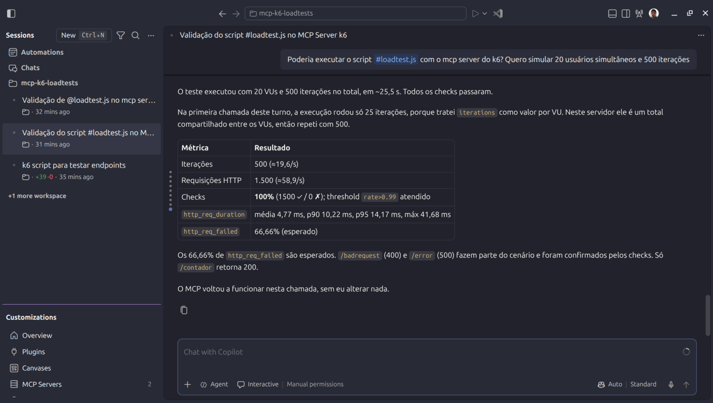
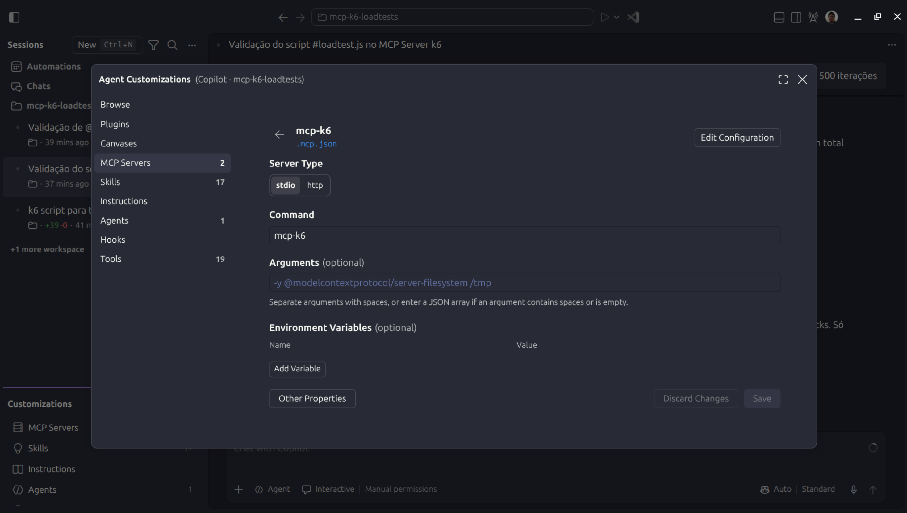

# mcp-k6-vscode-agents_loadtests-apicontagem
Exemplo de uso do MCP Server do k6 com testes de carga de uma API REST de contagem de acessos.

## Testes

Comandos para instalação em um ambiente Ubuntu:

```bash
curl -LO https://github.com/grafana/mcp-k6/releases/download/v0.7.0/mcp-k6_0.7.0_linux_amd64.deb
sudo dpkg -i mcp-k6_0.7.0_linux_amd64.deb
```

Arquivo **.mcp.json**:

```json
{
	"mcpServers": {
		"mcp-k6": {
			"type": "stdio",
			"command": "mcp-k6"
		}
	}
}
```

Testes com **Agents window** no **Visual Studio Code** (**Menu View > Command Palette... > Chat: Open Agents Windows**):



Para os testes deste MCP Server foi utilizada a versão 0.7.0: **https://github.com/grafana/mcp-k6/releases/tag/v0.7.0**

Configurações do MCP Server em **Agents windows**:


